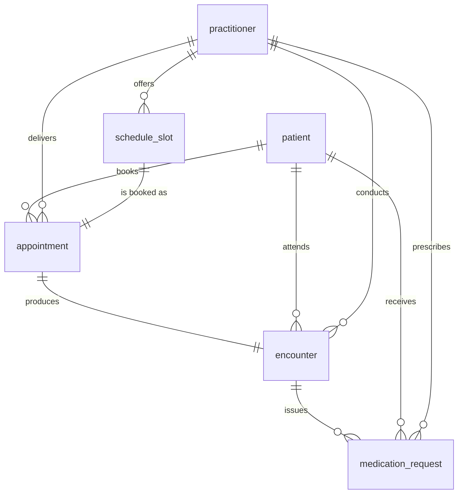

# Telemedicine MVP — core data model

- **Feature:** `ENG-001` — Define the data model and FHIR R4 resource mappings
- **Status:** Implemented, pending review. No application code exists yet; this document and
  [`db/schema.sql`](../db/schema.sql) define the model that the later features will build on.
- **Owner:** `OpenCode-20261019-b07bb18a`
- **Reviewed against:** HL7 FHIR R4 (version 4.0.1), verified field-by-field against the published
  StructureDefinitions on 2026-10-19. See [`fhir-mappings.md`](fhir-mappings.md) for the per-element
  mapping and the verification method.

## 1. Scope

This document defines the six clinical entities of the MVP and the relationships between them.

| Entity | Purpose | FHIR R4 resource | Backlog item that builds on it |
| --- | --- | --- | --- |
| `patient` | A person receiving care | `Patient` | ENG-002, ENG-003 |
| `practitioner` | The clinician delivering care | `Practitioner` | ENG-002, ENG-003 |
| `schedule_slot` | A bookable window in a practitioner's schedule | `Slot` (referenced, not exposed) | ENG-003 |
| `appointment` | A booked visit | `Appointment` | ENG-003, ENG-004 |
| `encounter` | The clinical encounter produced by a visit | `Encounter` | ENG-005 |
| `medication_request` | The e-prescription issued during or after an encounter | `MedicationRequest` | ENG-005 |

### Explicitly out of scope

The following are **not** defined here because other backlog items own them. Where the model needs a
pointer to them it uses an opaque text column rather than pre-empting their schema:

- Authentication, authorization, session/account tables and the audit log — **ENG-002**.
  `patient.account_ref` and `practitioner.account_ref` are reserved opaque references to the login
  account that ENG-002 will define.
- Availability editing, booking/reschedule/cancel rules, reminders and time-zone conversion
  behaviour — **ENG-003**.
- Video room lifecycle, admission control and join windows — **ENG-004**.
- Prescription PDF rendering, object storage and download authorisation — **ENG-005**.
  `medication_request` holds the clinical content; the document is derived from it.
- Audit trail rows, FHIR REST endpoints, search parameters and server-side profiles — **ENG-002**
  and **ENG-006**. The create/read audit entries required by ENG-005 are produced by that layer.

The MVP is a single-clinician practice, but the model is written to support several practitioners
and several patients, because the acceptance criteria in the README (no double-booking, correct
slot availability) are only meaningful with those constraints enforced in the database.

## 2. Conventions

- **Primary keys** are UUID v4 generated by the database. The UUID string is also the FHIR `id`
  element of the corresponding resource. FHIR `id` allows `[A-Za-z0-9\-\.]{1,64}`, which a UUID
  satisfies.
- **Business identifiers** are separate from primary keys. `patient.mrn` maps to `Patient.identifier`
  and `practitioner.npi` maps to `Practitioner.identifier` with the `http://hl7.org/fhir/sid/us-npi`
  system. The identifier system URIs are listed in [`fhir-mappings.md`](fhir-mappings.md) §2.
- **Instants** are stored as `timestamptz` and are always UTC internally. The IANA zone a practitioner
  works in is stored in `practitioner.timezone` and in `schedule_slot.timezone` using a zone name
  such as `America/New_York`. Wall-clock slot times are converted to UTC instants when the slot is
  created; the conversion rule (including DST gaps and overlaps) belongs to ENG-003 and is not
  implemented yet.
- **Granularity** is whole minutes. `schedule_slot` enforces this with a `CHECK` constraint.
- **Clinical data is never cascade-deleted.** All foreign keys use `ON DELETE RESTRICT`. Correction
  of a clinical record is expressed with a status, not by deleting the row.
- **Snake case** column names; `*_id` columns hold UUID references; `*_at` columns are instants;
  `*_text` columns are free text.

## 3. Entity relationships

Cardinality rules enforced in the database:

- `appointment.slot_id` is `UNIQUE` and the appointment window must equal the slot window, the
  slot's practitioner and the appointment's practitioner. This is enforced by a composite foreign
  key on `(slot_id, practitioner_id, starts_at, ends_at)`.
- `schedule_slot` carries a GiST exclusion constraint over
  `(practitioner_id, tstzrange(starts_at, ends_at))`, so a practitioner can never hold two
  overlapping slots.
- `encounter.appointment_id` is `UNIQUE` (one encounter per appointment) and the encounter's patient
  and practitioner must match the appointment's, via a composite foreign key.
- `medication_request` references its encounter with a composite foreign key on
  `(encounter_id, patient_id, prescriber_id)`, so a prescription can never be attached to a
  different patient or a different prescriber than the encounter it was issued during.

## 4. Entities

### 4.1 `patient`

Maps to `Patient`. One row per person receiving care.

| Column | Type | Null | Notes | FHIR R4 element |
| --- | --- | --- | --- | --- |
| `id` | `uuid` | no | Primary key; source of `Patient.id` | `Patient.id` |
| `mrn` | `text` | no | Unique medical record number | `Patient.identifier` (`system = .../identifier/mrn`) |
| `family_name` | `text` | no | | `Patient.name.family` |
| `given_names` | `text[]` | no | Given names, in order | `Patient.name.given` |
| `birth_date` | `date` | yes | Not in the future | `Patient.birthDate` |
| `gender` | `text` | no | `male`/`female`/`other`/`unknown` | `Patient.gender` |
| `phone` | `text` | yes | | `Patient.telecom` (`system = phone`) |
| `email` | `text` | yes | | `Patient.telecom` (`system = email`) |
| `address_line1`, `address_line2` | `text` | yes | | `Patient.address.line` |
| `address_city` | `text` | yes | | `Patient.address.city` |
| `address_region` | `text` | yes | | `Patient.address.state` |
| `address_postal_code` | `text` | yes | | `Patient.address.postalCode` |
| `address_country` | `text` | yes | | `Patient.address.country` |
| `account_ref` | `text` | yes | Opaque pointer to the ENG-002 account | — (not exposed) |
| `created_at`, `updated_at` | `timestamptz` | no | | `Patient.meta.lastUpdated` (from `updated_at`) |

**Invariants**

- `gender` always has a value. R4 binds `Patient.gender` to `administrative-gender` with strength
  *required*, so a value must be sent even when the patient has not disclosed one; `unknown` is used
  in that case.
- `birth_date` cannot be in the future (`patient_birth_date_not_future`).
- A patient's demographic fields are copied into the FHIR representation at read time; the API layer
  (ENG-006) is the single place where that projection happens.

### 4.2 `practitioner`

Maps to `Practitioner`. One row per clinician.

| Column | Type | Null | Notes | FHIR R4 element |
| --- | --- | --- | --- | --- |
| `id` | `uuid` | no | Primary key; source of `Practitioner.id` | `Practitioner.id` |
| `npi` | `text` | yes | Unique; National Provider Identifier | `Practitioner.identifier` (`system = http://hl7.org/fhir/sid/us-npi`) |
| `family_name` | `text` | no | | `Practitioner.name.family` |
| `given_names` | `text[]` | no | | `Practitioner.name.given` |
| `credentials` | `text[]` | no | Post-nominals, e.g. `MD` | `Practitioner.name.suffix` |
| `license_number` | `text` | yes | | `Practitioner.qualification[].identifier.value` |
| `license_region` | `text` | yes | Issuing region of the licence | `Practitioner.qualification[].issuer` |
| `gender` | `text` | no | `male`/`female`/`other`/`unknown` | `Practitioner.gender` |
| `specialty` | `text` | yes | e.g. `General Practice` | `Practitioner.qualification[].code.text` |
| `timezone` | `text` | no | IANA zone the clinician practises in | — (local convention, not a FHIR element) |
| `account_ref` | `text` | yes | Opaque pointer to the ENG-002 account | — (not exposed) |
| `created_at`, `updated_at` | `timestamptz` | no | | `Practitioner.meta.lastUpdated` |

**Invariants**

- `gender` always has a value (same required binding as `Patient.gender`).
- `npi` is unique when present; a practitioner without an NPI is allowed because the NPI is a
  US-specific identifier and the MVP does not fix a jurisdiction.

### 4.3 `schedule_slot`

Maps to `Slot`. A window the practitioner has opened for booking. Not one of the five core FHIR
resources, so ENG-006 does not expose it as an endpoint; `Appointment.slot` references it.

| Column | Type | Null | Notes | FHIR R4 element |
| --- | --- | --- | --- | --- |
| `id` | `uuid` | no | Primary key; source of `Slot.id` | `Slot.id` |
| `practitioner_id` | `uuid` | no | Owner of the slot | `Slot.schedule` → `Schedule.actor` → `Practitioner` |
| `starts_at` | `timestamptz` | no | UTC instant of the window start | `Slot.start` |
| `ends_at` | `timestamptz` | no | UTC instant of the window end | `Slot.end` |
| `timezone` | `text` | no | IANA zone used to render the slot | `Slot.schedule` → `Schedule` (planned local rendering) |
| `status` | `text` | no | `free`/`busy`/`busy-tentative`/`busy-unavailable`/`entered-in-error` | `Slot.status` |
| `created_at`, `updated_at` | `timestamptz` | no | | `Slot.meta.lastUpdated` |

**Invariants**

- `ends_at > starts_at`, the window is between 1 minute and 12 hours long, and both ends are on a
  whole minute.
- No two slots of the same practitioner overlap (`schedule_slot_no_overlap` exclusion constraint).
- A slot's `status` is advisory for the client; the authoritative occupancy rule is
  `appointment.slot_id IS UNIQUE` plus the composite foreign key from `appointment`.

### 4.4 `appointment`

Maps to `Appointment`. A booked visit.

| Column | Type | Null | Notes | FHIR R4 element |
| --- | --- | --- | --- | --- |
| `id` | `uuid` | no | Primary key; source of `Appointment.id` | `Appointment.id` |
| `patient_id` | `uuid` | no | Who booked | `Appointment.participant` (patient actor) |
| `practitioner_id` | `uuid` | no | Who delivers | `Appointment.participant` (practitioner actor) |
| `slot_id` | `uuid` | no | Unique; the booked window | `Appointment.slot` → `Slot` |
| `status` | `text` | no | `proposed`/`pending`/`booked`/`arrived`/`fulfilled`/`cancelled`/`noshow`/`entered-in-error`/`checked-in`/`waitlist` | `Appointment.status` |
| `starts_at` | `timestamptz` | no | | `Appointment.start` |
| `ends_at` | `timestamptz` | no | | `Appointment.end` |
| `duration_minutes` | `integer` | no | Must equal the window length | `Appointment.minutesDuration` |
| `reason_code` | `text` | yes | Code from the `encounter-reason` value set | `Appointment.reasonCode[0].coding.code` |
| `reason_text` | `text` | yes | | `Appointment.reasonCode[0].text` |
| `patient_note` | `text` | yes | Note shown to the patient | `Appointment.comment` |
| `cancellation_reason` | `text` | yes | Required when `status = 'cancelled'` | `Appointment.cancelationReason.text` |
| `cancelled_at` | `timestamptz` | yes | Required when `status = 'cancelled'` | `Appointment.meta` (not a first-class element) |
| `created_at`, `updated_at` | `timestamptz` | no | | `Appointment.meta.lastUpdated` |

**Invariants**

- The appointment window must equal the slot window and belong to the same practitioner
  (`appointment_slot_match`).
- `duration_minutes` must equal `(ends_at - starts_at) / 60`.
- A cancelled appointment must carry a cancellation reason and a cancellation timestamp.
- One slot can back at most one appointment, which together with the slot overlap constraint makes
  double-booking impossible at the storage layer.
- The state machine (`booked → arrived → fulfilled`, `booked → cancelled`, `booked → noshow`) is
  enforced by the application layer in ENG-003; the column check only restricts the value set.

### 4.5 `encounter`

Maps to `Encounter`. The clinical record of a visit.

| Column | Type | Null | Notes | FHIR R4 element |
| --- | --- | --- | --- | --- |
| `id` | `uuid` | no | Primary key; source of `Encounter.id` | `Encounter.id` |
| `appointment_id` | `uuid` | no | Unique; the visit this came from | `Encounter.appointment` → `Appointment` |
| `patient_id` | `uuid` | no | | `Encounter.subject` → `Patient` |
| `practitioner_id` | `uuid` | no | | `Encounter.participant[].individual` → `Practitioner` |
| `status` | `text` | no | `planned`/`arrived`/`triaged`/`in-progress`/`onleave`/`finished`/`cancelled`/`entered-in-error`/`unknown` | `Encounter.status` |
| `encounter_class` | `text` | no | `AMB` (v3 ActEncounterCode) | `Encounter.class` |
| `encounter_type` | `text` | no | `VR` (v3 ActCode, virtual). The MVP has one modality — browser video — and v3-ActCode has no telephone code, so the value set is deliberately narrow | `Encounter.type[0].coding.code` |
| `started_at` | `timestamptz` | no | | `Encounter.period.start` |
| `ended_at` | `timestamptz` | yes | | `Encounter.period.end` |
| `reason_code` | `text` | yes | | `Encounter.reasonCode[0].coding.code` |
| `chief_complaint` | `text` | yes | | `Encounter.reasonCode[0].text` |
| `clinical_note` | `text` | yes | | `Encounter.extension` (`…/encounter-clinical-note`) — see the mapping document, R4 `Encounter` has no free-text note element |
| `created_at`, `updated_at` | `timestamptz` | no | | `Encounter.meta.lastUpdated` |

**Invariants**

- One encounter per appointment (`appointment_id` is unique).
- The encounter's patient and practitioner must match the appointment's.
- `ended_at` must not precede `started_at`.

### 4.6 `medication_request`

Maps to `MedicationRequest`. The e-prescription.

| Column | Type | Null | Notes | FHIR R4 element |
| --- | --- | --- | --- | --- |
| `id` | `uuid` | no | Primary key; source of `MedicationRequest.id` | `MedicationRequest.id` |
| `encounter_id` | `uuid` | no | Encounter it was issued during | `MedicationRequest.encounter` → `Encounter` |
| `patient_id` | `uuid` | no | | `MedicationRequest.subject` → `Patient` |
| `prescriber_id` | `uuid` | no | The treating clinician | `MedicationRequest.requester` → `Practitioner` |
| `status` | `text` | no | `active`/`on-hold`/`completed`/`cancelled`/`entered-in-error`/`draft`/`stopped`/`unknown` | `MedicationRequest.status` |
| `intent` | `text` | no | `order` by default | `MedicationRequest.intent` |
| `medication_system` | `text` | no | Local catalogue URI | `MedicationRequest.medicationCodeableConcept.coding.system` |
| `medication_code` | `text` | no | | `MedicationRequest.medicationCodeableConcept.coding.code` |
| `medication_display` | `text` | no | | `MedicationRequest.medicationCodeableConcept.coding.display` |
| `authored_on` | `timestamptz` | no | | `MedicationRequest.authoredOn` |
| `dosage_text` | `text` | no | Directions in prose | `MedicationRequest.dosageInstruction[0].text` |
| `dose_quantity`, `dose_unit` | `numeric(10,3)`, `text` | yes | | `MedicationRequest.dosageInstruction[0].doseAndRate[0].doseQuantity` |
| `route_text` | `text` | yes | | `MedicationRequest.dosageInstruction[0].route.text` |
| `duration_days` | `integer` | yes | | `MedicationRequest.dosageInstruction[0].timing.repeat.boundsDuration` |
| `refills` | `integer` | yes | | `MedicationRequest.dispenseRequest.numberOfRepeatsAllowed` |
| `dispense_quantity` | `numeric(10,3)` | yes | | `MedicationRequest.dispenseRequest.quantity.value` |
| `notes` | `text` | yes | | `MedicationRequest.note[0].text` |
| `created_at`, `updated_at` | `timestamptz` | no | | `MedicationRequest.meta.lastUpdated` |

**Invariants**

- The prescription's patient and prescriber must match the encounter's.
- `status` and `intent` are restricted to the R4 value sets; `intent` defaults to `order`, which
  matches a prescription that is expected to be dispensed.
- `medication_system` / `medication_code` reference the local medication catalogue. No RxNorm or
  other national drug code is asserted in ENG-001: the MVP has no pharmacy integration, and
  inventing drug codes would be unverified. The mapping document records this as an open item for
  OPS-001.

## 5. Cross-cutting rules

1. **Time zone correctness.** Stored instants are UTC. `schedule_slot` carries the IANA zone it was
   authored in so that the ENG-003 UI can render the practitioner's local wall clock, and so that a
   DST transition can be detected at slot-creation time. All booking comparisons are done on the UTC
   instants, never on rendered local strings.
2. **Identifiers vs keys.** Primary keys are internal. Anything that appears on a prescription, in a
   confirmation message, or in an API consumer's system must use a business identifier
   (`patient.mrn`, `practitioner.npi`, or the resource id for the FHIR identifier of the
   appointment, encounter and medication request).
3. **Least data.** `patient` holds the minimum needed to deliver a consultation. The privacy gates
   in the README (consent, minimum-necessary access, retention) are OPS-001 and are not yet
   satisfied; the model does not store anything that would make them harder to satisfy later
   (no free-form clinical notes beyond the encounter note, no payment or insurance data).
4. **Auditability is additive.** Because clinical rows are never deleted, the ENG-002 audit log can
   record access and change events against stable ids. `created_at`/`updated_at` support that trail
   but are not a substitute for it.

## 6. Open items and deferred decisions

| # | Item | Why it is open | Owner |
| --- | --- | --- | --- |
| 1 | Medication terminology source (local catalogue vs RxNorm) | No pharmacy integration in the MVP; OPS-001 must confirm the jurisdiction's requirement before a national code is asserted | OPS-001 / ENG-005 |
| 2 | Identity provider and the shape of `account_ref` | Authentication model is not decided | ENG-002 |
| 3 | `schedule_slot` recurrence | ENG-003 may need repeating templates rather than materialised slots; the model supports materialised slots only | ENG-003 |
| 4 | Encounter reason code value set | `encounter-reason` is extensible and the MVP has no diagnostic vocabulary yet | ENG-003 / ENG-005 |
| 5 | Diagnosis capture | R4 models diagnoses as `Condition` references, which are outside the five core resources; not modelled in ENG-001 | ENG-005 / ENG-006 |
| 6 | Retention and purge schedule for clinical rows | Required by the README privacy gate; affects `created_at`-based expiry jobs | OPS-001 |
